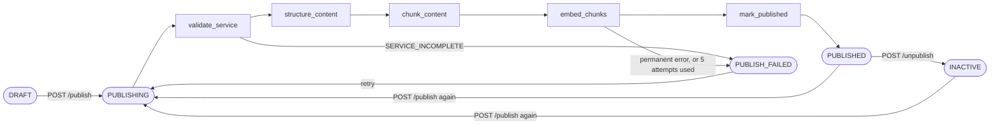
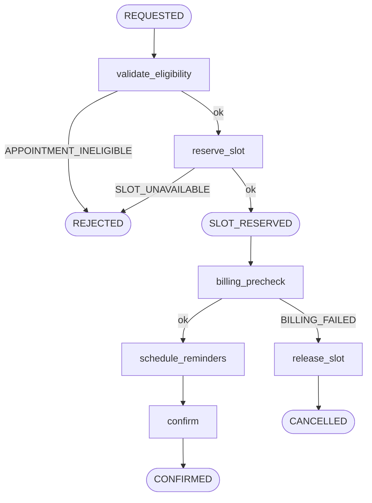

# Design

How SmartHealth is put together, and why. Updated as work lands.

- [1. Data model](#1-data-model)
- [2. Three things that will bite in Week 2](#2-three-things-that-will-bite-in-week-2)
- [3. Decisions and tradeoffs](#3-decisions-and-tradeoffs)
- [4. Open questions](#4-open-questions)
- [5. Module breakdown](#5-module-breakdown)
- [6. Publish workflow and scheduling saga](#6-publish-workflow-and-scheduling-saga) *(Week 2)*
- [7. Slot concurrency](#7-slot-concurrency) *(Week 2)*

---

## 1. Data model

### 1.1 ERD — core domain and chunk vectors

Twenty entities. The ten Week 1 shapes, everything the scheduling saga and
visit lifecycle attach to them, Week 4's chunk vectors, and Week 5's AI
records.

```mermaid
erDiagram
    CLINIC ||--o{ DEPARTMENT : "contains"
    DEPARTMENT ||--o{ PROVIDER : "employs"
    DEPARTMENT ||--o{ SERVICE : "offers"
    SPECIALTY ||--o{ PROVIDER : "classifies"
    USER ||--o| PATIENT : "may be"
    USER ||--o| PROVIDER : "may be"
    PROVIDER ||--o{ PROVIDER_SCHEDULE : "works"
    PROVIDER ||--o{ SLOT : "has"
    PROVIDER ||--o{ PROVIDER_SERVICE : "is qualified for"
    SERVICE ||--o{ PROVIDER_SERVICE : "delivered by"

    PATIENT ||--o{ APPOINTMENT : "books"
    PROVIDER ||--o{ APPOINTMENT : "sees"
    SERVICE ||--o{ APPOINTMENT : "for"
    SLOT ||--o{ APPOINTMENT : "occupies"
    APPOINTMENT ||--o{ APPOINTMENT_STATUS_HISTORY : "logs"
    APPOINTMENT ||--o{ SLOT_RESERVATION : "holds"
    SLOT ||--o{ SLOT_RESERVATION : "held by"
    APPOINTMENT ||--o| BILLING : "pre-checked by"
    APPOINTMENT ||--o| VISIT : "becomes"
    PROVIDER ||--o{ WAITLIST : "queued for"
    PATIENT ||--o{ WAITLIST : "waits on"
    CONTENT_CHUNK ||--o| CHUNK_EMBEDDING : "embedded as"
    SERVICE ||--o{ CHUNK_EMBEDDING : "described by"
    USER ||--o{ AI_INTERACTION : "asks or generates"
    AI_INTERACTION ||--o| GENERATED_CONTENT : "produced"
    APPOINTMENT ||--o{ GENERATED_CONTENT : "written about"
    USER ||--o{ GENERATED_CONTENT : "created"

    CLINIC {
        bigint id PK
        text name UK
        text timezone "IANA name, e.g. Asia/Karachi"
        timestamptz created_at
        timestamptz updated_at
    }

    DEPARTMENT {
        bigint id PK
        bigint clinic_id FK "NOT NULL"
        text name
        int order_index "display ordering"
        timestamptz created_at
        timestamptz updated_at
    }

    SPECIALTY {
        bigint id PK
        text name UK "controlled vocabulary"
        timestamptz created_at
        timestamptz updated_at
    }

    USER {
        bigint id PK
        text email UK
        text password_hash "never leaves the DB layer"
        text role "enum patient|provider|front_desk|admin"
        boolean is_active
        timestamptz created_at
        timestamptz updated_at
    }

    PATIENT {
        bigint id PK
        bigint user_id FK "UNIQUE, NOT NULL"
        date dob
        jsonb contact "PHI"
        timestamptz created_at
        timestamptz updated_at
    }

    PROVIDER {
        bigint id PK
        bigint user_id FK "UNIQUE, NOT NULL"
        bigint department_id FK "NOT NULL"
        bigint specialty_id FK "NOT NULL"
        text bio
        timestamptz created_at
        timestamptz updated_at
    }

    PROVIDER_SCHEDULE {
        bigint id PK
        bigint provider_id FK "NOT NULL"
        smallint weekday "0=Mon .. 6=Sun"
        time start_time "clinic-local time of day"
        time end_time "clinic-local time of day"
        smallint slot_duration_minutes "default 15"
        boolean is_active
        timestamptz created_at
        timestamptz updated_at
    }

    SERVICE {
        bigint id PK
        bigint department_id FK "NOT NULL"
        text name
        text description
        text prep_instructions
        text status "enum DRAFT|PUBLISHING|PUBLISHED|PUBLISH_FAILED|INACTIVE"
        timestamptz published_at "null until published"
        timestamptz created_at
        timestamptz updated_at
    }

    SLOT {
        bigint id PK
        bigint provider_id FK "NOT NULL, indexed"
        timestamptz start_time "UTC"
        timestamptz end_time "UTC"
        text status "enum AVAILABLE|RESERVED|BOOKED|BLOCKED, indexed"
        timestamptz created_at
        timestamptz updated_at
    }

    PROVIDER_SERVICE {
        bigint id PK
        bigint provider_id FK "NOT NULL"
        bigint service_id FK "NOT NULL, indexed"
        timestamptz created_at
        timestamptz updated_at
    }

    APPOINTMENT {
        bigint id PK
        bigint patient_id FK "NOT NULL, indexed"
        bigint provider_id FK "NOT NULL, indexed"
        bigint slot_id FK "NOT NULL, indexed"
        bigint service_id FK "NOT NULL, indexed"
        text status "enum REQUESTED|SLOT_RESERVED|CONFIRMED|COMPLETED|REJECTED|CANCELLED"
        text idempotency_key UK "the client's Idempotency-Key header"
        timestamptz booked_at "null until CONFIRMED"
        timestamptz created_at
        timestamptz updated_at
    }

    APPOINTMENT_STATUS_HISTORY {
        bigint id PK
        bigint appointment_id FK "NOT NULL, indexed"
        text from_status "null only on the creation row"
        text to_status "NOT NULL"
        text actor "PATIENT|FRONT_DESK|PROVIDER|ADMIN|SAGA|SAGA_COMPENSATION"
        text reason "operational only, never patient text"
        timestamptz created_at
        timestamptz updated_at
    }

    SLOT_RESERVATION {
        bigint id PK
        bigint appointment_id FK "NOT NULL, indexed"
        bigint slot_id FK "NOT NULL, indexed"
        text status "enum RESERVED|RELEASED|COMMITTED"
        timestamptz created_at
        timestamptz updated_at
    }

    BILLING {
        bigint id PK
        bigint appointment_id FK "UNIQUE, NOT NULL"
        numeric amount "fixed placeholder; no pricing model exists"
        text status "enum PENDING|CHECKED|FAILED|REFUNDED"
        text idempotency_key UK
        timestamptz created_at
        timestamptz updated_at
    }

    VISIT {
        bigint id PK
        bigint appointment_id FK "UNIQUE, NOT NULL"
        text status "enum CHECKED_IN|IN_PROGRESS|COMPLETED, indexed"
        timestamptz checked_in_at "NOT NULL; the row exists only from check-in"
        timestamptz completed_at "null until COMPLETED"
        timestamptz created_at
        timestamptz updated_at
    }

    WAITLIST {
        bigint id PK
        bigint provider_id FK "NOT NULL, indexed"
        bigint patient_id FK "NOT NULL, indexed"
        text status "enum WAITING|OFFERED, indexed"
        timestamptz created_at "with id, the queue position"
        timestamptz updated_at
    }

    CONTENT_CHUNK {
        bigint id PK
        text source_type "enum SERVICE; generic by design"
        bigint source_id "no FK -- see decisions"
        int chunk_index
        text text
        int token_count
        text text_hash
        timestamptz embedded_at "null until Week 4"
        timestamptz created_at
        timestamptz updated_at
    }

    CHUNK_EMBEDDING {
        bigint id PK
        bigint chunk_id FK "UNIQUE, ON DELETE CASCADE"
        vector embedding "vector(384)"
        text model
        bigint service_id FK "NOT NULL, indexed"
        text department "copied for search"
        text_array specialties "copied for search"
        boolean published "copied for search"
        timestamptz created_at
        timestamptz updated_at
    }

    AI_INTERACTION {
        bigint id PK
        bigint user_id FK "NOT NULL"
        text correlation_id "indexed"
        text intent "nullable"
        text outcome
        jsonb retrieved_ids "ids only"
        text model
        text safety_prompt_version
        text prompt_version
        int input_tokens
        int output_tokens
        int latency_ms
        int answer_chars
        timestamptz created_at
        timestamptz updated_at
    }

    GENERATED_CONTENT {
        bigint id PK
        text kind
        bigint appointment_id FK "summary and follow-up only"
        date report_start "report only"
        date report_end "report only"
        jsonb content
        text model
        text prompt_version
        bigint created_by FK "NOT NULL"
        bigint interaction_id FK "UNIQUE"
        timestamptz created_at
        timestamptz updated_at
    }
```



Exported copies of this and every other diagram here live in `docs/diagrams/`.
`erd-core-domain.svg` predates the two Week 5 tables.

**Conventions applied to every table.** Integer (`bigint`) identity primary keys.
`created_at` / `updated_at` as `timestamptz`, always UTC-aware — never a naive
datetime. Every foreign key is `ON DELETE RESTRICT`: in healthcare operations you
deactivate, you never delete, and a cascade that quietly removed a department's
services would take their history with it. Status is always an enum, never a
boolean flag. `chunk_embeddings` breaks both rules once each, for derived data
rather than records (see the Week 4 decisions). Indexes on anything filtered or joined: `slots.provider_id`,
`slots.status`, `services.status`, `services.department_id`,
`providers.department_id`.

### 1.2 What each table is — and is not

**Clinic** — the physical site that owns departments. It is *not* a tenant
boundary: multi-clinic sync is explicitly out of scope, and no query is scoped by
clinic. It exists as a table rather than a string on `departments` so the name is
stored once, and it carries `timezone` because it is the only place that knows how
to turn a provider's local working hours into UTC slot boundaries.

**Department** — an organisational grouping inside a clinic that owns both
providers and services. It is *not* a specialty: a department groups people and
offerings ("Orthopaedics"), while a specialty describes one provider's expertise.
Keeping them separate means a department can hold providers of several specialties
without either concept having to stretch.

**Specialty** — a controlled vocabulary of provider expertise. It is *not*
clinical content: it describes a provider, never a patient, and nothing here
diagnoses anything. It is a table rather than a free-text column because Week 4
retrieval filters on specialty as vector metadata, and "Cardiology" vs
"cardiology" vs "Cardiolgy" as three distinct values would silently break that
filter. The cost is one join and a seeded list.

**User** — an identity: the thing that logs in. It is *not* a person's record.
Role-specific facts live on `patients` and `providers`, so this table stays the
same shape for every role and never carries columns that are null for half its
rows. A `User` row is never serialised to a client — it holds `password_hash`.

**Patient** — the patient's operational profile. It is *not* a medical record:
`dob` and `contact` only, with no diagnoses, prescriptions, lab results or
clinical notes anywhere in the system. `contact` is PHI, so it is written to the
database and nowhere else — logs, events and `ai_interactions` carry `patient_id`.
It is JSONB rather than columns because contact details are a shifting bag of
phone / email / preferred channel, validated by a Pydantic model at the schema
layer so it does not become a junk drawer.

**Provider** — the clinician's operational profile: who they are, where they sit,
what they specialise in. It is *not* a schedule and *not* availability. Provider
time lives entirely in `provider_schedules` (the intent) and `slots` (the
concrete, bookable reality).

**ProviderSchedule** — a recurring weekly working-hours template in clinic-local
time, from which slots are generated in bulk. It is *not* availability itself:
nothing is bookable until a `Slot` row exists. There is deliberately **no foreign
key from `slots` back to a schedule** — once generated, a slot is independent.
That is what makes "the provider changed their Tuesday hours" tractable: editing a
template affects only future generation runs and can never retroactively move or
delete a slot someone has already booked.

**Service** — an operational offering a patient can be pointed at: what it is,
what it costs the patient in preparation, whether it is currently offered. It is
*not* a clinical procedure record; `description` and `prep_instructions` are
logistics ("arrive 15 minutes early, bring previous imaging"), never clinical
advice. Its lifecycle is a `status` enum rather than an `is_published` boolean,
because Week 2 needs to distinguish "being published right now" and "publishing
failed" from "not published" — three states one boolean cannot hold.

**Slot** — one bounded interval of one provider's time, as a discrete row. It is
*not* a boolean `is_available` flag on the provider, and this is the single most
important shape in the system. A boolean has no identity, so an appointment cannot
point at it, no history can reference it, and two concurrent writers can both flip
it with nothing to conflict over. A row has a primary key an appointment can
reference, a `status` the database can arbitrate with one conditional `UPDATE`,
and a lifetime that can be audited. A slot is also *not* service-specific — it is
provider time; the service is chosen when the appointment is created.

**ProviderService** — a join table stating a fact nothing else in the schema can:
that this provider is qualified to deliver this service. *Not* inferred from a
shared `department_id` — a department groups people and offerings, it does not
certify who performs what. Added Day 3, ahead of Week 2's eligibility check and
task 1.8's `has_available_slots` search filter, both of which need the real
answer.

---

## 2. Three things that will bite in Week 2

These are Week 1 shapes chosen specifically because Week 2 depends on them. Getting
them wrong now means a schema rewrite mid-Temporal-week.

### 2.1 `slots.status` is an enum, because the concurrency guarantee needs something to guard on

The core invariant of the whole assignment is that reserving a slot is a **single
atomic conditional update**:

```sql
UPDATE slots SET status = 'RESERVED'
WHERE id = :slot_id AND status = 'AVAILABLE'
RETURNING id;
```

No row returned means someone else got there first, and the booking is rejected
cleanly. The `WHERE status = 'AVAILABLE'` clause is the entire guarantee — it is
what makes the statement a compare-and-swap rather than a blind write, and it
requires a status column on the row being updated.

`SELECT` the slot, check it in Python, then `UPDATE` is **not** acceptable: two
requests both read `AVAILABLE`, both conclude the slot is free, and both book it.
The gap between the check and the act is the bug, and no amount of application
code closes it. The database must be the arbiter.

Four values, because Week 2's saga needs to distinguish them:

| Status | Meaning |
|---|---|
| `AVAILABLE` | Generated and bookable. The only status the reservation UPDATE will accept. |
| `RESERVED` | Held by an in-flight booking saga. Not yet confirmed — may be released by compensation. |
| `BOOKED` | The saga completed; a confirmed appointment owns this slot. |
| `BLOCKED` | Provider time off. Never bookable, and never becomes `AVAILABLE` by itself. |

`RESERVED` and `BOOKED` must be separate: compensation after a billing failure has
to release the slot back to `AVAILABLE`, and it can only know that is safe if the
status says the booking never completed.

### 2.2 One provider cannot have two overlapping slots

Two slots that overlap in time are two separate rows, so the atomic UPDATE above
protects neither from the other — both can be reserved, and the provider is
double-booked with no constraint violated anywhere. The invariant has to be
enforced where the rows are, in the database.

A unique constraint on `(provider_id, start_time)` is the obvious move and it is
worth having, but on its own it is **not sufficient**: 09:00–09:30 and 09:15–09:45
have different start times, so the constraint permits both.

**Decision: enforce overlap properly with a Postgres exclusion constraint**, and
keep the unique constraint alongside it for the common case, where it produces a
clearer error.

```sql
CREATE EXTENSION IF NOT EXISTS btree_gist;

ALTER TABLE slots ADD CONSTRAINT ck_slots_end_after_start
    CHECK (end_time > start_time);

ALTER TABLE slots ADD CONSTRAINT uq_slots_provider_id_start_time
    UNIQUE (provider_id, start_time);

ALTER TABLE slots ADD CONSTRAINT ex_slots_no_overlap
    EXCLUDE USING gist (
        provider_id WITH =,
        tstzrange(start_time, end_time) WITH &&
    );
```

The extension goes in via an Alembic migration, exactly as pgvector did — never by
hand on a running database. This is the same principle as the reservation UPDATE:
state the rule once, where the data is, rather than hoping every code path that
inserts a slot remembers to check.

### 2.3 `services.status` + `published_at` give the Week 2 Temporal workflow a state machine

Publishing a service is a Temporal Workflow, not a boolean flip:

```
DRAFT ──publish──> PUBLISHING ──success──> PUBLISHED ──unpublish──> INACTIVE
                        └──failure──> PUBLISH_FAILED ──retry──> PUBLISHING
PUBLISHED or INACTIVE ──publish again──> PUBLISHING   (Week 4)
```

The workflow validates the service is complete, structures its operational
content, chunks it, embeds it (Week 4) and marks it published. That takes real
time and can fail partway, so the row has to be able to say *"a publish is running
right now"* and *"the last publish failed"* — states an `is_published` boolean
cannot represent. `PUBLISHING` is also what makes the endpoint honest: `POST
/services/{id}/publish` returns `202` plus a workflow id, and
`GET /services/{id}/publish-status` reports where it got to.

Two consequences already baked into the Week 1 schema:

- Illegal entry transitions (publishing something already `PUBLISHING`) are
  rejected with `409` in one place *before* the workflow starts, which requires
  the current status to be readable on the row.
- `published_at` is nullable and set only on success. It is the timestamp Week 4's
  retrieval filter reads alongside `status = 'PUBLISHED'` — never recommend a
  service the clinic does not currently offer.

The status column exists in Week 1 even though nothing moves it yet. That is
deliberate: the state machine is a schema decision, and adding it later would mean
migrating rows that had already been created without it.

---

## 3. Decisions and tradeoffs

| Decision | Why | Tradeoff |
|---|---|---|
| `users` split from `patients` / `providers` (table-per-role) | Role-specific columns can be `NOT NULL` — `providers.department_id` is a real enforced rule, which it could never be on a merged table full of nulls | Every "who is this?" query joins; creating a patient touches two tables in one transaction |
| FK on the dependent side (`patients.user_id`), with `UNIQUE` | A user may have no patient profile; putting `patient_id` on `users` would need two nullable columns plus a constraint saying "exactly one is set". `UNIQUE` on the FK is what makes it 1:1 rather than 1:N | The 1:1 is enforced by a constraint a reader has to notice, not by the column's position |
| A patient must have a user account | Simpler auth, and PHI scoping keys off the authenticated user with no second path | No walk-in patients without a login; front desk must create an account to register someone |
| One user may hold both a patient and a provider profile | A clinician can be a patient at their own clinic; forbidding it buys nothing | `role` is a single value, so such a user's role has to pick one — resolved in the service layer |
| Single `role` enum, not a `user_roles` join table | Specified by the brief, and four roles with no overlap in practice | Someone genuinely needing two roles needs two accounts |
| `Specialty` as an entity, not a string | Week 4 filters retrieval on specialty metadata; free text makes "Cardiology"/"cardiology" different values and silently breaks the filter | An extra join and a seeded vocabulary to maintain |
| `Clinic` as an entity, not a string on `departments` | Stores the name once and gives the timezone a home — schedule templates are local, slots are UTC, and something has to own the conversion | An extra table for what is one row in Week 1 |
| `ProviderSchedule` template, with slots generated from it | The week's brief is "provider schedules"; a template expresses recurring intent once instead of restating working hours on every generation call | A second concept to keep coherent with the slots it produced |
| No FK from `slots` back to `provider_schedules` | Editing a template must never retroactively move or delete a slot someone has booked; once generated, a slot stands alone | Cannot ask "which template produced this slot?"; the link exists only in the generation run |
| `slot.status = BLOCKED` for time off, not a separate entity | The status enum already models "not bookable"; a second table would need reconciling with the slots it overlaps | Time off can only be expressed where slots have been generated |
| All FKs `ON DELETE RESTRICT` | Operations data is deactivated, never deleted — the same reason a cancelled appointment is transitioned rather than removed | Deleting test data by hand needs the right order |
| `patients.contact` as JSONB | Contact details are a shifting bag of phone / email / preferred channel; the brief specifies JSONB and rules out a second database | Not queryable as columns; needs a Pydantic model at the schema layer or it becomes a junk drawer |
| Enums stored as `VARCHAR` + `CHECK`, not a native Postgres `ENUM` type | Status values get added and renamed as the workflows are built, and a native enum has no clean reversal — Postgres has no `DROP VALUE`, so downgrading a value addition means recreating the type and re-casting the column. A check constraint is symmetric to add and drop, so migrations stay reversible | Slightly more storage; `ORDER BY status` sorts alphabetically rather than by lifecycle order; the vocabulary cannot be shared as one type across tables |
| Integer identity primary keys | Event envelopes carry ids (`"appointment_id": 812`), which stay readable in logs and demos; integer joins are cheaper | Ids are enumerable, so access control must be real authorization, never obscurity |
| Slots stored in UTC, schedules in clinic-local time | Naive local datetimes are on the assignment's list of common mistakes; a single stored timezone means one conversion point | Reading raw slot rows during a demo needs a mental offset |
| 15-minute default slot duration | Confirmed with mentor for seed data | — |
| Slot overlap prevented by a Postgres `EXCLUDE`, not only by `UNIQUE (provider_id, start_time)` | Two slots that overlap have *different* start times, so the unique constraint permits them; checking in the generator is the same check-then-act gap as SELECT-then-UPDATE. `EXCLUDE` is evaluated as part of the insert, so there is no window | Needs the `btree_gist` extension; its GiST index answers overlap questions but serves ordered range scans poorly, so the unique constraint is kept alongside it for that index |
| Email uniqueness enforced on `lower(email)` | Postgres compares text byte-for-byte, so a plain unique constraint would let one person hold two accounts differing only in capitalisation, each with its own patient row and booking history. Enforcing it in the database means a seed script or psql session cannot bypass it | Every lookup must be written `WHERE lower(email) = :email` or the index is not used |
| `weekday` is `0 = Monday`, matching Python's `date.weekday()` | The slot generator is Python walking dates; the Postgres `EXTRACT(DOW)` convention would put a `+1 % 7` in the hottest logic of Week 1, and an off-by-one there produces slots on the wrong days with no error at all | Disagrees with `EXTRACT(DOW)` if the column is ever read from raw SQL; guarded by `CHECK (weekday BETWEEN 0 AND 6)` and stated on the column |

### Week 2

| Decision | Why | Tradeoff |
|---|---|---|
| A separate `slot_reservations` table, rather than inferring the hold from `appointments.status` | The reserve must survive a crash between the UPDATE and the status write; a status column set in a later statement cannot record that window | A second row per booking attempt, and a table that only exists to make one Activity idempotent |
| `reserve_slot` split into an uncommitted core plus a committing wrapper | Lets the saga's Activity share one transaction with its own `slot_reservations` insert, so the flip and the record commit together | Two functions where callers might expect one; the uncommitted one is a footgun if called directly |
| Deterministic workflow ids (`publish-service-{id}`, `schedule-appointment-{id}`) | Temporal rejects a second execution under a live id, which is a second guard against a concurrent double-publish independent of the status check | An id already used cannot be reused after completion without a policy decision |
| Booking idempotency in Redis **and** a unique constraint on `appointments.idempotency_key` | Redis answers "seen this key" before any row exists; the constraint is the last-resort guarantee if Redis is evicted or unavailable | Two mechanisms to keep in step, and a race between them handled by catching the unique violation |
| `get_redis` as a FastAPI dependency, not a module-level import | Tests can point route code at the test Redis database exactly as they do with `get_db`; without it the suite writes 24h-TTL keys into the app's real Redis and fails on its *second* run | One more dependency threaded through the endpoint signature |
| Each compensation written out explicitly, not behind a generic mechanism | The failure modes differ — two need no compensation at all — and a generic runner would hide that asymmetry | Repetition in the Workflow body; a fourth failure mode means another explicit branch |
| Patient resolution ("self or on behalf of") in `services/patient.py`, not in the routers | Booking and waitlist-joining ask the identical question, and a duplicated access-control rule is how one copy silently drifts | An extra indirection between the router and the thing it is creating |
| Waitlist entries point at a provider, not a slot | Someone joining a queue does not know which slot will free up, only whose time they want; a per-slot queue dies the moment that slot is booked | Cannot express "I only want Tuesday mornings" |
| Waitlist uniqueness is a **partial** index (`WHERE status = 'WAITING'`) | An `OFFERED` entry is history and must not block a fresh join; a plain unique index would lock a patient out of that queue permanently after their first offer | Partial indexes are easy to lose in an autogenerated migration — pinned by a test that rejoins after an offer |
| Queue position is `(created_at, id)`, not a position column | A position needs renumbering whenever anyone leaves, and Postgres `now()` is transaction-scoped so timestamps alone can tie | Relies on `id` ordering matching arrival order, which sequences give but do not promise under concurrency |

### Week 3

| Decision | Why | Tradeoff |
|---|---|---|
| `processed_events` is keyed on `(consumer, event_id)`, not `event_id` alone | Idempotency is per-consumer: each consumer must handle an event exactly once. Keyed on `event_id` alone, adding a second consumer would make it skip every event the first had already seen — silently, and looking exactly like correct de-duplication. Appendix B lists `consumer` as a column but not as part of the key; a column recorded and never enforced is a fact the schema does not actually hold | The key is wider, and every lookup must supply the consumer name — a handler that forgets it gets no rows rather than an error |
| No `processed_at` column; `created_at` is that moment | The marker row and the aggregate update commit in the same transaction, so the two timestamps could only ever hold the same value. Same reasoning as `outbox_events.created_at` doubling as the envelope's `occurred_at` | A reader expecting Appendix B's column list has to be told; stated in the model docstring |
| Composite primary key, no surrogate `id` | Nothing references this table by foreign key and the pair is already unique, so an `id` would identify nothing that `(consumer, event_id)` does not. Same reasoning as `analytics_daily` keying on `date` | Inserting a row means knowing both parts of its identity; there is no short handle to quote in a log line |
| The Kafka consumer is the only writer of `analytics_daily`; the Celery Beat rollup is retired | A five-minute recompute overwrote the consumer's increments, and a check that writes can never report drift | A missed event stays wrong until 3.7's reconciliation is run |
| `avg_wait_seconds` replaced by `wait_seconds_total` + `wait_count` | An average cannot be incremented — it has forgotten how many values produced it. Its two components can | The division moves to read time, so anything reading the table directly must do it too |
| Total patients and failed jobs are counted directly, not stored as aggregates | No event announces either, so no aggregate could be kept current, and a stored copy would duplicate a number the source table already holds | Two of the six metrics are not served from aggregates, which the Definition of Done words as though all six are |
| The duplicate guard is `ON CONFLICT DO NOTHING … RETURNING`, not a caught `IntegrityError` | A violated constraint aborts the whole transaction — the one the handler still has to run in | Postgres-specific; the guard would not port to another database unchanged |
| A permanent failure dead-letters and then commits the offset; a transient one rewinds with `seek` | An offset is a position rather than a checklist, so refusing to move it blocks every message behind one bad one | Misclassifying a failure either loses an event or stalls a partition |
| Handlers bucket by the raw column the reconciliation reads, not the envelope's `occurred_at` | The two are microseconds apart, but either side of midnight they disagree, and the check would report drift that was never real | Each event costs a lookup of the row it is counting |
| The analytics series is not paginated; a 366-day range cap bounds it instead | Paginating a chart makes the client reassemble it, and `total` would only restate the number of days it asked for | Deviates from the project-wide `{items, total, limit, offset}` convention for list endpoints |
| Metrics are published by three processes, not one | A process can only count what it saw, and `reserve_slot` runs in the Temporal worker, not the API | Every domain counter must be summed with `sum by (job)`; reading one target under-reports |
| HTTP metrics are labelled by route template, never the URL | One label per appointment id is unbounded cardinality — the standard way people take down their own Prometheus | Unmatched paths share a single `unmatched` label, so a genuine 404 pattern is invisible in the metric |
| `/health/ready` returns the per-dependency breakdown, and 503 rather than 500 | The reader is a monitor, not an API client: *which* dependency is the whole payload, and a load balancer treats "not ready" differently from "broken" | It is the one endpoint that does not use the project-wide error envelope |
| Reconciliation writes nothing; `--repair` is a separate, manual action | A check that fixes what it finds destroys the evidence before anyone reads the report | Drift persists until a human acts, so it has to be alerted on — hence the script exiting 1 |
| A missing `analytics_daily` row is compared as zeros, not skipped | A consumer that died before ever writing a day would otherwise look healthy | A genuinely quiet day is recomputed to prove it is quiet |
| The wait-time recompute counts only COMPLETED visits | `handle_visit_completed` is its only writer and runs on `visit.completed`, so a visit still in progress has contributed nothing yet | Found on Day 5; the recompute previously counted every visit checked in that day, so a clinic mid-visit saw phantom drift for most of the working day |

### Week 4

| Decision | Why | Tradeoff |
|---|---|---|
| Vectors live in the existing Postgres through pgvector, rather than in a separate vector database such as Qdrant or Chroma | Retrieval has to keep only published services and scope any patient data to the caller, so both filters must be part of the search query itself. With pgvector they are plain `WHERE` clauses in the same statement that orders by distance. A service's chunks and vectors can also be replaced in one transaction, so a re-publish cannot leave stale vectors behind (task 4.7). The `pgvector/pgvector` image and the `CREATE EXTENSION` migration have been in place since Week 1, so there is no new container to run or back up | With no vector index, each search compares the query against every stored vector. A single clinic has few enough services for that scan to stay small; a much larger catalogue would need an approximate index (HNSW) that skips most of those comparisons. Such an index applies `WHERE` filters after its scan, so with the published filter it can return fewer than k results, which is a second reason not to add one at this size. Search is also tied to Postgres, so moving to a dedicated store later goes through `VectorStore` in `app/ai/vector_store.py` (task 4.6) |
| Embeddings come from Hugging Face's hosted `all-MiniLM-L6-v2` (384 numbers per text), rather than OpenAI's `text-embedding-3-small` or a model run inside the container with `fastembed` | `.env.example` asks for free keys the developer provisions, which rules out paid OpenAI. A hosted call fails for real (a TLS handshake timed out on the first day of testing), so task 4.5's retries are exercised by genuine failures; a local model would need a forced-failure switch to show them, and would make the image larger | The first request after an idle period took 8 s against 0.9 s warm, and the free tier is rate-limited, both risks on demo day. The model is small and ranks paraphrases poorly (`docs/ai-layer.md` section 3). Switching is one class and one setting behind `EmbeddingProvider`, plus re-embedding every service, because vectors from different models cannot be compared. Replaced as the default on Day 2; see the next row |
| Day 2: the same model runs inside the containers (`LocalEmbeddings`, using `fastembed`), which is now the default; the hosted provider stays as an option | The free Hugging Face account ran out of inference credits after about a day of testing, and every call returned HTTP 402. A demo that depends on an outside quota can be stopped by it. Run locally, the model gave the same scores as the hosted API to three decimals on all six Day 1 queries, so search results do not change | The image is about 290 MB larger (200 MB of packages, 87 MB of model downloaded at build time), and each process holds the model in memory and loads it once, in about 0.6 s. A real network failure no longer exercises the retry path by default; tests cover it, and the hosted provider is one setting away. Changing the model needs an image rebuild as well as a migration |
| Each vector is a row in its own `chunk_embeddings` table, one per chunk, and deleting a chunk deletes its vector (`ON DELETE CASCADE`), the schema's only cascade | A vector is computed from its chunk's text and means nothing without it, and `chunk_content` deletes a service's chunks on every publish. With `RESTRICT`, the second publish of any embedded service would fail on that delete. With the cascade, Postgres removes the old vector in the same statement, so no orphan can survive a re-publish | Deleting a chunk now removes its vector without a trace, the one place a delete is not refused. Since task 4.9, `chunk_content` keeps a chunk whose text is unchanged, so the cascade fires only when the text really changed and the vector is stale anyway |
| Each vector carries copies of its service's department, specialties and a `published` flag, as Part B §3.1 requires, not only `service_id` | The store sits behind `VectorStore` so it can be swapped, and a store such as Qdrant cannot join to `services` at search time, so the metadata has to travel with the vector. Specialties are a list because a service can be delivered by providers of several specialties | A copy can disagree with its source. The flag only changes in the same transaction as the service's status, and department and specialties are rewritten on every publish, so they describe what was embedded. A department renamed without a re-publish keeps its old name on the vector until the next one |
| Embedding gets its own retry policy, five attempts 2, 4, 8 and 16 s apart, after which the publish ends in `PUBLISH_FAILED` | Temporal's default policy retries forever, so a provider outage would leave the service in `PUBLISHING` with nothing saying why. Five attempts ride out a model loading (Hugging Face's 503) or a short rate limit | A provider outage longer than about 30 s fails the publish, and someone has to publish the service again |
| Why a publish failed is saved on the row, `services.publish_error`, as well as in Temporal's history | `publish-status` can say why without Temporal being reachable. A validation failure used to end in `PUBLISH_FAILED` with no reason anywhere outside Temporal | One more column, cleared each time a publish starts |
| `publish-status` asks Temporal for the pending Activity's attempt number and last error while a service is `PUBLISHING` | The row only says `PUBLISHING`. Temporal already tracks each pending Activity's attempt and last failure, which is what makes a retrying embedding call visible | That part of the endpoint now depends on Temporal; when Temporal is unreachable it returns the row without `progress` instead of failing |
| `embed_chunks` re-raises provider errors as `ApplicationError` `from None` | Temporal sends an exception's whole cause chain, with a stack trace per link, and stores a retrying Activity's last failure only up to a size limit. A timeout's httpx chain measured 3.7 KB, and `publish-status` showed "Failure exceeds size limit." until the chain was dropped | The worker log loses the httpx traceback; the message keeps the underlying exception's name, such as `ConnectTimeout` |
| Every vector is stored with `published = false`; only `mark_published` sets it true, in the same transaction as the service's status | Embedding runs while the service is still `PUBLISHING`. Writing the flag true at that point would make the service searchable before its publish finished, and a publish that then failed would leave it searchable | A re-publish hides the service from search from the moment its vectors are replaced until the workflow finishes. Whether that is acceptable is part of the open re-publish question (task 4.7) |
| Publishing again goes straight from `PUBLISHED` or `INACTIVE` to `PUBLISHING`, not back through `DRAFT` (task 4.7) | It is how an edited service's chunk and vector catch up with its text. A trip through `DRAFT` would add a step that checks nothing | While the workflow runs, a second or two, the service is out of search and booking rejects it; a failed re-publish keeps it out until a publish succeeds |
| `start_publish` and unpublish lock the service row (`SELECT ... FOR UPDATE`) before checking its status | Once `PUBLISHED` could be published, two clicks both read `PUBLISHED` and both passed; Temporal refused the second workflow, and its rollback marked the service `PUBLISHED` while the first workflow was still running. Without the lock, 5 of 20 concurrent requests got past the check | A second request waits for the first to commit, then gets a 409 |
| Unpublish is a transaction, not a workflow, and keeps the chunks and vectors | One status and one flag change together, with nothing to retry or resume; kept vectors mean publishing again re-embeds nothing unchanged | No `service.unpublished` event: no consumer needs one yet |
| `POST /search` filters in the vector query itself: the vector's `published` flag, the query's model, and the threshold as a maximum cosine distance (task 4.8) | A filter applied after ranking would let an unpublished or weak match take one of the `top_k` places; in the query, Postgres drops them first. The brief requires the published filter in the query, not the prompt | The vector store has to carry `published` itself, which section 4's flag already does |
| The similarity threshold is server configuration (`RETRIEVAL_MIN_SIMILARITY`); `top_k` is a request field | A client able to lower the threshold could ask for noise, which is what the threshold exists to hide | Tuning it needs a config change and restart, not a request |
| Alembic's `fileConfig` runs with `disable_existing_loggers=False` | The suite runs migrations in-process after importing the app, and the default switched off every `app.*` logger for the whole run, so no test could check a log line. Found when the test that search never logs the query captured nothing | Alembic's own logging config can no longer silence an app logger, which nothing relied on |
| The seed catalogue has 12 services, four per department, including close pairs such as Knee X-Ray and Knee MRI Scan (task 4.10) | With 3 services, every query's right answer was in the top 5, so the eval's top-5 hit rate could only read 100%. The close pairs are where search can pick the wrong service | `make reset` publishes 12 services one at a time: about 50 s |
| `RETRIEVAL_MIN_SIMILARITY` is 0.31, chosen from the eval set (task 4.10) | Unrelated not-offered queries scored at most 0.298 and every offered query's service at least 0.332, so any value between gets 31 of the 34 queries right. 0.31 leans towards finding, because a patient told a real service is not offered cannot book it | Three not-offered queries that ask for a kind of service the clinic offers, such as "chest x-ray", score above it and get a weak match instead of "we don't offer that". The value holds for `all-MiniLM-L6-v2` only |

### Week 5

| Decision | Why | Tradeoff |
|---|---|---|
| A thin httpx client for the model, rather than a vendor SDK or LangChain (task 5.1) | httpx was already a dependency. Groq takes OpenAI's request format, so one class serves both, and the embedding provider's error split and `MockTransport` tests carry over | The stream is parsed by hand. No Anthropic: its format differs |
| Default model `qwen/qwen3.8-27b` (task 5.1) | `llama-3.1-8b-instant` was gone. Of Groq's four chat models, qwen was fastest to its first words (0.09 s) and spends no tokens reasoning (`docs/ai-layer.md` section 9) | Chosen from one question, run once per model |
| The refusal and "we don't offer that" are fixed text, and the code adds the disclaimer to every reply (task 5.2) | The behaviour the brief weights highest never depends on a model's wording, and the disclaimer is never missing or doubled | A refusal cannot adapt to the question, and routes only to what retrieval found |
| Prompt versions are frozen, held by a hash test and a docs-quote test (task 5.2) | Each answer's row names its version, which must keep meaning the same words | Rewording a prompt means a new version and a new hash |
| `ai_interactions` stores no question or answer text (task 5.7) | The brief says no PHI and "Store ids, not patient text". The question is the patient's own words; the answer can repeat them and holds appointment times | A wrong answer can be explained from the row's ids, versions and model, but not replayed |
| An `outcome` enum in place of Appendix B's `refused` boolean (task 5.7) | An interaction ends one way, and flags could say two; status enums over booleans is the Week 1 rule | Analytics read `outcome = 'REFUSED'` |
| `correlation_id`, `safety_prompt_version` and `answer_chars` added to Appendix B's columns (task 5.7) | The brief requires the correlation ID; a question passes two prompts; `answer_chars` shows how far an interrupted answer got | Three more columns |
| `/assistant/ask` runs retrieval before the safety check (task 5.3) | Every path needs the services: an answer is grounded in them, a refusal names them. The database work then ends before any model call | A question that is then refused still costs an embedding |
| `/assistant/ask` is `async def`; embedding and the database run in `asyncio.to_thread`, and the transaction ends before the model call (task 5.3) | The seconds spent waiting on the model hold neither the event loop nor a pooled connection, so booking is never starved | One session is used from two threads, one after the other |
| `PROMPT_PREP_V2` shows the caller's appointments and the services found, with open times, for preparation and availability alike; V1 kept, frozen (task 5.5) | One prompt covers "my appointment" and "a service" questions without the code guessing which was meant | V1 is in the code though no route uses it |
| Appointments are read only for preparation and availability questions, filtered on `patients.user_id` from the token (task 5.5) | PHI is read only when the question needs it, and nothing in the question can widen the filter | A navigation question that mentions "my appointment" is answered from the services |
| A booking question with nothing found still goes to the model (task 5.5) | "What should I bring tomorrow?" names no service; "we don't offer that" would be wrong | One model call even when both lists are empty |
| `retrieved_ids` gains `slots` (task 5.5) | An availability answer can be checked against the slots it was shown | Slot ids point at rows whose status has moved on since |
| `/assistant/ask` is for patients only (task 5.3) | It is the patient assistant: booking conversion is per patient, and task 5.5 scopes appointments to the caller | Front desk cannot ask it on a patient's behalf |
| A question is refused on `medical_advice` or when the reply names no label (task 5.4) | A reply the code cannot read shows nothing about whether the question is safe | A formatting slip by the model refuses a safe question |
| `STAFF_GENERATION` is an intent but never a safety label (task 5.7) | The brief's analytics list it beside the other intents, so the column accepts it now rather than through a constraint migration in task 5.9 | One enum mixes the model's labels with a code-only value; `parse_intent()` rejects it |
| A separate `POST /assistant/ask/stream`, with `/ask` kept as it was (task 5.8) | Each route returns one type. `/ask` still serves Swagger, which cannot show a stream as it arrives, and its tests | Two routes to document; both share `_prepare()`, so their answers cannot drift apart |
| Retrieval and the safety check run before the stream starts (task 5.8) | Their failures stay ordinary JSON errors, and no text is sent before a refusal is decided | The 200 waits 0.6 to 1.1 s; a failure after it can only be an `error` event |
| `SSEResponse` closes its generator when the response ends (task 5.8) | Starlette 0.41 never closes it after a disconnect, so an interrupted answer was recorded 106 s late, at the next reload | Every stream must use `SSEResponse` rather than Starlette's `StreamingResponse` |
| A stream's final write runs in `anyio.CancelScope(shield=True)` (task 5.8) | A disconnect cancels the request, and anyio would cancel the write recording it too | The cancellation waits for one insert |
| A stream's final write reuses the request's session after `get_db` has closed it (task 5.8) | FastAPI 0.115 closes yield dependencies before the stream starts; SQLAlchemy 2.0 lets a closed session be used again, and the tests' session override keeps working | Depends on that SQLAlchemy behaviour; checked live with `pg_stat_activity` |
| Every number in a utilisation report is read by the code; the model writes only commentary, and a digit in it fails validation (task 5.9) | The brief: "never let the model invent figures". A number the model never writes cannot be wrong | The commentary cannot quote a figure, and a wrong comparison in words still passes |
| The report's analytics figures are `summarise_range()` through `AnalyticsSummaryResponse` (task 5.9) | The same function and schema as `GET /analytics/summary`, so "its numbers match analytics" holds by construction | Total patients and failed jobs come along, though they say little about utilisation |
| Department utilisation is counted from `slots` (task 5.9) | `analytics_daily` has no department; adding one would mean a consumer change and a reconciliation for it | A count on each request, with no aggregate or reconciliation behind it |
| The repair retry shows the model its own reply and the problem (task 5.9) | The model can fix the reply rather than start again. The problem text is written by the code, so no model text is echoed | A repaired report costs two calls' tokens |
| `generated_content` links its `ai_interactions` row rather than repeating the outcome; every run saves both, interrupted and failed included (task 5.10) | One record of outcome, tokens and latency, and the brief's "still persist what was generated" | Two commits per run; reading an outcome needs a join |
| Appendix B's `report_scope` is `report_start` and `report_end`, with a check constraint per kind (task 5.10) | Dates that can be queried, and no row can mix an appointment with a range | Two columns where the appendix names one |
| No model call before a generation stream starts (task 5.9) | There is no patient text, so no safety check to run first | A provider that is down shows as an `error` event after a 200 |
| Staff generation has its own model dependency, failing as `GENERATION_UNAVAILABLE` (task 5.9) | A staff member's 503 names generation, not the patient assistant | Two near-identical dependencies |
| AI metrics counted in `record_interaction()`, after its commit, with every series started at zero (task 5.11) | Every AI path ends there, so none is missed, and the metrics count the same interactions as the table. Without the zero start, `increase()` missed the first refusal | Model calls are not counted on their own: a provider failure that a retry recovered shows nowhere |
| `GET /analytics/ai` counts from `ai_interactions` on each request, not from an aggregate table (task 5.11) | The p95 latency needs every latency in the range, which a stored sum and count cannot give | Slower as the table grows; the range is capped at 366 days and `created_at` is indexed |
| Booking conversion is per patient: of those who asked a question, how many booked within 24 hours after one (task 5.11) | A patient who asks five questions and books once is one conversion, not five | The 24-hour window is a judgment, and a booking is credited to the assistant whether or not the answer led to it |
| The AI rate limit is a Redis counter per user per clock minute, one count across the five AI routes (task 5.12) | One `INCR` per request, as the brief suggests. One count, because the limit protects one model budget | A fixed window: up to twice the limit across a minute boundary |
| With Redis down, AI requests go ahead, logged and counted (task 5.12) | The limit guards a budget; refusing all AI requests would take the assistant down with Redis | No limit during the outage, and each request waits 3 to 4 s for the failed lookup |
| The limit is a dependency declared after the role check (task 5.12) | FastAPI resolves dependencies in order, so a 403 never uses up a request | It runs before the body is checked, so a 422 does |
| The answer cache key hashes everything the reply depends on, the services found included (task 5.12) | Unpublishing or editing a service, or a new prompt version, needs no invalidation code: the key changes and the old entry is never found | Each lookup still embeds the question; a question whose retrieval differs misses |
| Only replies holding nothing about the patient are cached, and shared by every patient (task 5.12) | A preparation answer holds the caller's appointments and must never reach another patient | Booking questions always call the model; reply text sits in Redis for the TTL |
| A hit never extends the TTL, and a store never overwrites (`SET NX`) (task 5.12) | A popular reply is written afresh every hour, never served indefinitely | A popular question costs one model call an hour |
| `cache_hit` is a boolean column on `ai_interactions` (task 5.12) | A fact about a finished interaction, with no states to move through; the status-enum rule is for rows that change | A migration for one column |

**Enum member names and values are kept identical** (`AVAILABLE = "AVAILABLE"`).
SQLAlchemy persists a Python enum's `.name`, while a `str`-based enum serialises
its `.value` through Pydantic — so if the two differ, the database holds one
string and the API returns another, and a hand-written query in the runbook
silently matches nothing.

**The check constraint is not automatic.** SQLAlchemy's `Enum(...)` defaults to
`create_constraint=False`, which produces an unconstrained `VARCHAR` — the enum
would then guarantee nothing in the database, and a seed script or psql session
could write any string at all. Every enum column is therefore built through one
helper in `app/models/enums.py` that sets the flag, so it cannot be forgotten on
one column out of three.

**Resolved: `providers` and `services` are linked via `provider_services`.** This
was originally recorded as a known gap deferred to Week 2 (a shared department
alone doesn't certify who performs what — a dermatology service and a
cardiologist could otherwise pair up with nothing to stop it). Built ahead of
schedule on Day 3, once task 1.8's search filters made the gap concrete: a
genuine many-to-many, not inferred from department.

**Known gap: overlapping *schedule* windows for one provider are not prevented.**
Mon 09:00–12:00 and Mon 11:00–14:00 can both be stored. Postgres ships no range
type for `time`, and creating a custom one would be exactly the hand-maintained
database object rejected when choosing enum storage. The invariant that matters
— no provider double-booked — is enforced where it matters: overlapping windows
can only cause harm by producing overlapping slots, and that insert is rejected
by `ex_slots_no_overlap`. The cost is that the failure surfaces at generation
time rather than at schedule-creation time; a service-layer check should point
at the right place.

**`status = 'PUBLISHED'` and `published_at IS NOT NULL` are not the same fact.**
`published_at` means "when it last went live", not "it is live now" — an
`INACTIVE` service keeps its timestamp. They are deliberately not tied together
by a constraint. Always read `status` for liveness; never infer it from
`published_at`.

**Known gap: nothing at the database level ties `users.role` to which profile table
a user has.** A user with `role = 'patient'` could in principle have a provider row
and no patient row. Enforced in the service layer at creation, and covered by a
test.

**Known gap (Week 2): a booking whose workflow never started stays `REQUESTED`.**
The row is committed before `start_workflow` is called, so if Temporal is
unreachable at that moment nothing retries it and no compensation runs — deleting
the row is not an option. A retry with the same `Idempotency-Key` returns the
stuck appointment rather than restarting the saga. A sweeper for rows left
`REQUESTED` past a threshold is the fix; the same window exists in
`start_publish`, where the status is rolled back but the gap is identical.

**Known gap (Week 2): cancel, reschedule and the visit lifecycle are not built.**
Tasks 2.10 (partly) and 2.11, carried into Week 3. Consequently the waitlist can
be joined but nothing promotes an entry to `OFFERED`, because promotion is what
cancellation triggers.

**Known limitation (Week 3): analytics buckets are UTC calendar days.**
Every event handler and the reconciliation check bucket by UTC midnight, not by
the clinic's local midnight. The two always agree with each other — they read the
same column — so this never shows up as drift. It shows up as the boundary being
in the wrong place: a clinic several hours from UTC sees its late-afternoon
appointments counted on the following day.

Not fixed, and deliberately so. It touches four handler sites, three boundary
computations, eight test files and needs a backfill of every stored row, and it
is in neither the Week 3 task list nor the Definition of Done. Slots already
store UTC and clinics already own a timezone, so the conversion point exists —
this is a change of which timezone the aggregates use, not new machinery.

**Resolved in the Week 3 review: a worker outage lost booking counts.**
`appointment.booked` is queued when the appointment is still `REQUESTED`, but
`booked_at` is written later, by the saga's `confirm` Activity.
The old `handle_appointment_booked` read `booked_at` with `scalar_one_or_none()`,
so a missing row and an unconfirmed one were indistinguishable — both looked like
"does not exist", which the handler treated as permanent and dead-lettered.

Normally invisible: the relay runs every 5s and a saga finishes in ~200ms, so
`booked_at` is always set by the time the event ships. Day 5's crash-recovery
demo held the sagas frozen for ~40s while the relay kept publishing, and all 27
booking events were dead-lettered — the aggregate silently under-counted until
`--repair` was run.

The fix: `appointments_booked` is maintained from `appointment.confirmed`,
which is recorded in the same transaction that sets `booked_at`, so the column
is guaranteed to exist and matches what the reconciliation already counts.
`appointment.booked` is still published and now drives nothing. The handler
also reads the row with `one_or_none()` rather than `scalar_one_or_none()`, so a
missing row and an empty `booked_at` dead-letter with different messages.

Making the unconfirmed case *transient* was the tempting wrong fix: a REJECTED
appointment never gets a `booked_at`, so the consumer would retry forever and
stall the partition.

Verified live against Day 5's own scenario: with the Temporal worker stopped,
the `booked` event arrived while `booked_at` was NULL and was ignored, not
dead-lettered; on restart the `confirmed` event counted it, and the
reconciliation was clean with no `--repair`.

---

## 4. Open questions

- Confirm a single clinic is sufficient for Week 1 — assumed yes.
- Confirm treating slots as the schedule (generated from templates) rather than
  computing availability on the fly is the expected shape.

---

## 5. Module breakdown

```
api/v1/    auth, departments, services (+ public /search), providers,
           provider_schedules (+ generate-slots). Parse input, call a
           service, shape the response — no business logic, no SQL.
services/  Business rules: uniqueness checks, role/ownership checks,
           slot generation. One module per api/v1 router, same name.
models/    SQLAlchemy ORM. Database shape only.
schemas/   Pydantic request/response. No ORM object ever leaves an endpoint;
           writable schemas omit any field only a workflow may set (e.g.
           Service.status).
core/      config, security (bcrypt + JWT), dependencies (get_current_user,
           require_role, ensure_patient_self_or_staff), exceptions +
           error_handlers (one JSON error shape), pagination.
```

Every router endpoint is admin/staff-gated with `require_role` except
`GET /services/search`, which is deliberately public — a prospective patient
browsing before they register is the point of task 1.8.

## 6. Publish workflow and scheduling saga

Both run on Temporal. A Workflow function orchestrates and nothing else — no
clock, no `random`, no database, no network — because Temporal replays it on
recovery and it must make the same decisions every time. All I/O lives in
Activities, which can be retried at any point and are therefore idempotent.

Activities are methods on a class holding an injectable `session_factory`, not
bare functions: an Activity has no `Depends(get_db)` to override, so that
factory is how a test points them at the test database.

### 6.1 Service publishing



`validate_service` returns every missing field at once and is **non-retryable** —
a missing description is still missing on the next attempt. That failure is
expected, so the Workflow catches it and ends cleanly in `PUBLISH_FAILED`;
anything else is left to Temporal's retry policy. `chunk_content` keeps a chunk
whose text hash is unchanged and replaces any other, in one transaction. That is
how re-publishing replaces chunks atomically, how a retried attempt stays
idempotent (the second run finds nothing changed), and how an unchanged chunk
keeps its vector instead of being embedded again.

`embed_chunks` calls an outside service, so it has its own retry policy: five
attempts, 2, 4, 8 and 16 s apart. A permanent error (a rejected key, a vector of
the wrong size) is non-retryable and fails at once. Either way the Workflow then
ends in `PUBLISH_FAILED` and saves the error in `services.publish_error`, which
`GET /services/{id}/publish-status` returns. The details are in
`docs/ai-layer.md` section 5.

### 6.2 Appointment scheduling saga



Three failures are expected rather than bugs, and each has its own exit:

| Failure | Compensation | Terminal state |
|---|---|---|
| Ineligible — service unpublished, provider doesn't offer it, slot isn't theirs | none; nothing was reserved | `REJECTED` |
| Slot lost to a competing booking | none; this appointment never held it | `REJECTED` |
| Billing pre-check fails | `release_slot` — slot back to `AVAILABLE`, reservation `RELEASED` | `CANCELLED` |

**Compensation is not rollback.** `reserve_slot` already committed, so undoing it
is a new write, not a transaction abort. The appointment row is never deleted.

Every transition writes `appointment_status_history` with an actor: `PATIENT` /
`FRONT_DESK` / `ADMIN` for human actions, `SAGA` for a saga step, and
`SAGA_COMPENSATION` for a rollback — so the audit trail distinguishes a
compensating write from an ordinary one.

How each Activity survives a retry:

| Activity | Retry-safe because |
|---|---|
| `validate_eligibility` | read-only |
| `reserve_slot` | checks for an existing `(appointment, slot)` reservation first |
| `billing_precheck` | `BillingChecker` reuses an existing billing row |
| `schedule_reminders` | no-op until Week 3 |
| `confirm` | returns early if already `CONFIRMED` |
| `release_slot` | returns early if already `CANCELLED` |
| `reject` | acts only from `REQUESTED` |

`GET /appointments/{id}` and `GET /services/{id}/publish-status` read the status
column rather than querying Temporal: the Activities keep it in sync at every
step. Since Week 4, publish-status also asks Temporal for the pending Activity's
attempt and last error while a service is `PUBLISHING`, and answers without them
if Temporal is unreachable. The cost is that a workflow lost before its first Activity leaves a row
claiming `REQUESTED` forever — see the known gaps in [3](#3-decisions-and-tradeoffs).

## 7. Slot concurrency

The atomic conditional UPDATE, and why SELECT-then-check-then-UPDATE races, are
in [2.1](#21-slotsstatus-is-an-enum-because-the-concurrency-guarantee-needs-something-to-guard-on).
Week 2 added three things on top.

**Proven, not asserted.** A test fires 50 threads at one slot and asserts exactly
one wins. It opens its own engine sized for 50 connections — the shared fixture's
default pool (5 + 10 overflow) would serialise most attempts before they reached
Postgres, and the test would pass while testing nothing.

**`slot_reservations` makes reserving retry-safe.** The UPDATE alone cannot tell a
retry from a fresh attempt: a retried Activity sees the slot already `RESERVED`
and would wrongly conclude a competitor won it. So `reserve_slot` checks for an
existing reservation row for that `(appointment, slot)` pair first. The UPDATE and
the insert commit together, so there is no window where the slot is flipped but
unrecorded — which is why `reserve_slot` is split into an uncommitted core and a
committing wrapper.

**Two different guarantees.** The UPDATE protects one row from two writers;
`ex_slots_no_overlap` ([2.2](#22-one-provider-cannot-have-two-overlapping-slots))
protects two rows from overlapping in time. Neither substitutes for the other.
